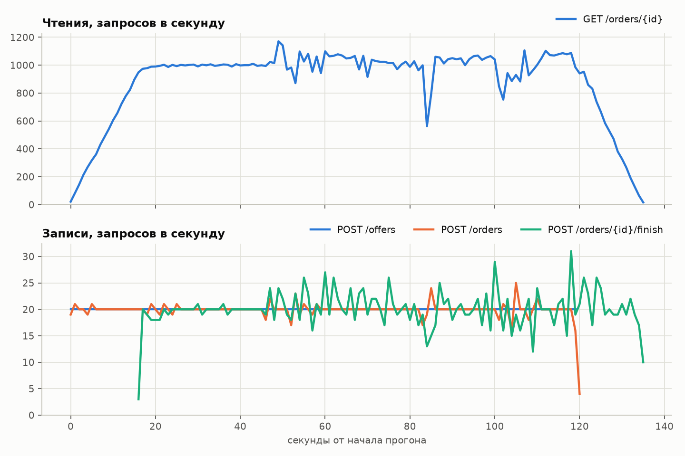
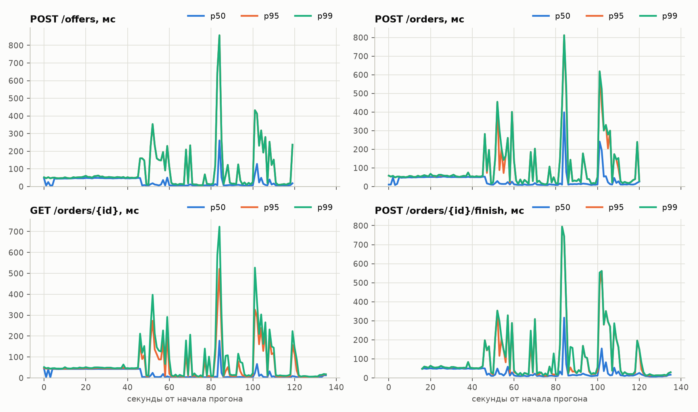
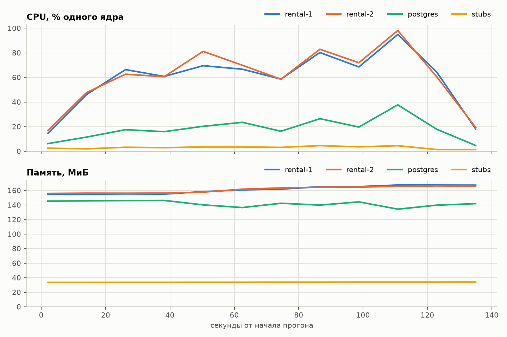

# Отчёт о тестировании

Стенд: `docker compose up -d --build` на одной машине (Colima, 4 CPU, 6 ГБ): PostgreSQL 16, `stubs-service`,
два экземпляра `rental-service`, архиватор и S3-совместимое хранилище. Эмулятор нагрузки
запускался на той же машине снаружи контейнеров.

## Smoke-тесты

```bash
pip install -r requirements.txt
pytest tests/smoke
```

32 теста, все проходят, лог: [smoke-tests.log](../load/results/smoke-tests.log). Тесты ходят в оба экземпляра
`rental-service`, переключают режимы `stubs-service` и проверяют состояние прямо в базе.

| Сценарий | Что проверяется |
| --- | --- |
| Цены оффера | подписка, доверенный пользователь, скидка за низкий заряд |
| Сбой scooters | оффер не создаётся, 503 |
| Сбой users | антифрод-цена, полный залог, без скидки за подписку |
| Сбой zones и configs | офферы создаются по данным из кэша на обоих экземплярах |
| Поездка целиком | оффер, старт, просмотр, завершение, стоимость, `score` |
| Просмотр заказа | работает при недоступных внешних источниках |
| Повторный старт | 32 параллельных запроса на два экземпляра дают один заказ и один hold |
| Истёкший оффер | 410, оффер становится `expired`, заказ не создаётся |
| Отказ hold | 402, заказ удалён, оффер снова `created` |
| Неизвестный hold | 202 и `pending_start`, повтор доводит заказ до `active` |
| Короткая поездка | `cancelled`, сумма 0, `score` не меняется |
| Повторное завершение | 32 параллельных запроса с разными ключами дают один clear и +1 к `score` |
| Чужой ключ идемпотентности | 409, второй заказ остаётся активным |
| Неизвестный clear | заказ закрыт, повтор с тем же ключом доводит оплату, `score` меняется один раз |
| Отказ clear | долг на сумму поездки, −20 к `score`, повтор не создаёт второй долг |
| Долг | старт запрещён до погашения, погашение идемпотентно и даёт +10 |
| Режим «гаек» | залог у доверенного пользователя, отказ при `score` ниже порога |
| Архив | старые закрытые заказы уходят в файл и удаляются из базы вместе с оффером, платежами и ключами |
| Архив и долги | заказ с непогашенным долгом или неизвестной оплатой остаётся в базе |
| Архив офферов | старые неиспользованные офферы удаляются |

Архиватор в контейнере проверен отдельно: `docker compose run --rm -e ARCHIVE_RUN_ONCE=1 archiver` перенёс
5 заказов в бакет `orders-archive` одним файлом `orders/dt=<день>/<uuid>.jsonl.gz` и удалил их из PostgreSQL.

## Нагрузка X = 20, Y = 50

```bash
pip install -r load/requirements.txt
python -m load.emulator --rps 20 --views 50 --duration 120 --ride-seconds 15 --out load/results/x20-y50
python -m load.report load/results/x20-y50
```

Эмулятор каждые 50 мс начинает новую поездку: создаёт оффер, стартует заказ, 50 раз за 15 секунд смотрит заказ и
завершает его. Запросы чередуются между двумя экземплярами. На плато это 20 офферов, 20 стартов, 20 завершений и
1000 просмотров в секунду, как в оценке из ADR.

Замер ниже сделан, когда в каждом экземпляре было по два воркера uvicorn. Потом воркер оставили один (см. ниже),
повторить двухминутный прогон после этого не удалось: ноутбук был занят другой нагрузкой, и на 1000 RPS виртуальная
машина Docker дважды переставала отвечать. Короткие прогоны по 20–40 секунд на том же стенде проходят без ошибок.

Поездок начато 2400, завершено 2400. Все 127 200 запросов получили 200, это же число видно в логах сервисов:
[rental.log](../load/results/x20-y50/rental.log).

| Эндпоинт | Запросов | RPS | Ошибок | p50, мс | p95, мс | p99, мс | max, мс |
| --- | ---: | ---: | ---: | ---: | ---: | ---: | ---: |
| `POST /offers` | 2400 | 20 | 0 | 14.89 | 109.9 | 261.04 | 857.21 |
| `POST /orders` | 2400 | 20 | 0 | 22.4 | 89.76 | 398.3 | 812.13 |
| `GET /orders/{id}` | 120000 | 1000 | 0 | 5.95 | 64.45 | 197.16 | 1003.87 |
| `POST /orders/{id}/finish` | 2400 | 20 | 0 | 16.71 | 117.91 | 316.44 | 794.52 |

| Контейнер | CPU средний, % | CPU пик, % | Память пик, МиБ |
| --- | ---: | ---: | ---: |
| rental-1 | 59 | 95 | 168 |
| rental-2 | 61 | 98 | 166 |
| postgres | 18 | 38 | 146 |
| stubs | 3 | 5 | 34 |

CPU указан в процентах одного ядра. Сырые данные: [summary.json](../load/results/x20-y50/summary.json),
[stats.csv](../load/results/x20-y50/stats.csv).







## Что нашли и поправили

- **Пул соединений.** С двумя воркерами на экземпляр и пулом 20 + 10 четыре процесса вместе просили до 120
  соединений при лимите PostgreSQL в 100. В минутном прогоне 417 запросов из 63 600 получили 500 с ошибкой
  `too many clients already`. Пул уменьшен до 10 + 5 на процесс (`DB_POOL_SIZE`, `DB_MAX_OVERFLOW`), после этого
  ошибок нет.
- **Два воркера uvicorn.** Пробовали запускать по два воркера на экземпляр. Одиночный запрос к `/health` внутри
  контейнера при этом занимал около 45 мс против 0,3 мс с одним воркером, поэтому воркер оставлен один. Двухминутный
  прогон с одним воркером до этой правки тоже прошёл без ошибок: просмотр заказа p50 3,9 мс, p95 177 мс, p99 302 мс.
- **Опрос `docker stats`.** При опросе каждые 2 секунды задержки всех эндпоинтов одновременно подскакивали до
  300 мс. В 20-секундном прогоне без опроса p95 просмотра был 10 мс. В итоговом прогоне метрики контейнеров
  снимаются раз в 10 секунд.

## Ограничения замера

- Сервисы, база и эмулятор делят одну машину, запросы идут через проброс портов Docker. Выбросы задержек до секунды
  при среднем CPU около 60% мы связываем со стендом, а не с сервисом, но отдельно это не доказано.
- Запас по CPU небольшой: один экземпляр на 500 просмотрах в секунду занимает 60–80% ядра. Для продакшена нужно
  больше экземпляров или ядер, чем на этом стенде.
- Прогон длится две минуты, база почти пустая. Поведение на объёме в сотни гигабайт из ADR не проверялось.
- `stubs-service` отвечает мгновенно. Сбои внешних источников проверены smoke-тестами, под нагрузкой они не включались.
- Каждая поездка идёт от нового пользователя, поэтому долги и режим «гаек» под нагрузкой не участвуют.
