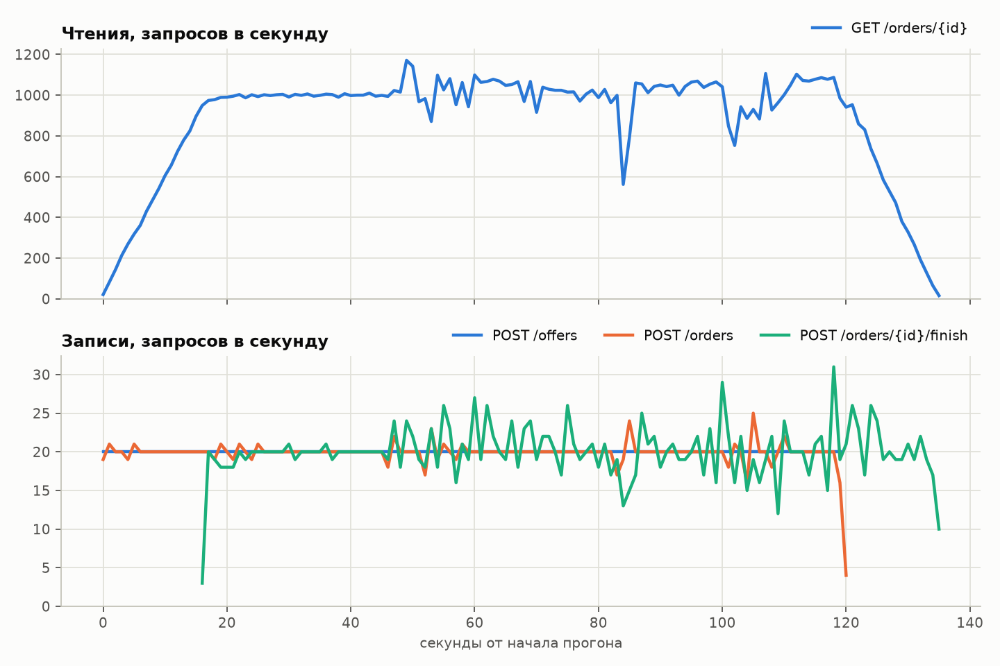
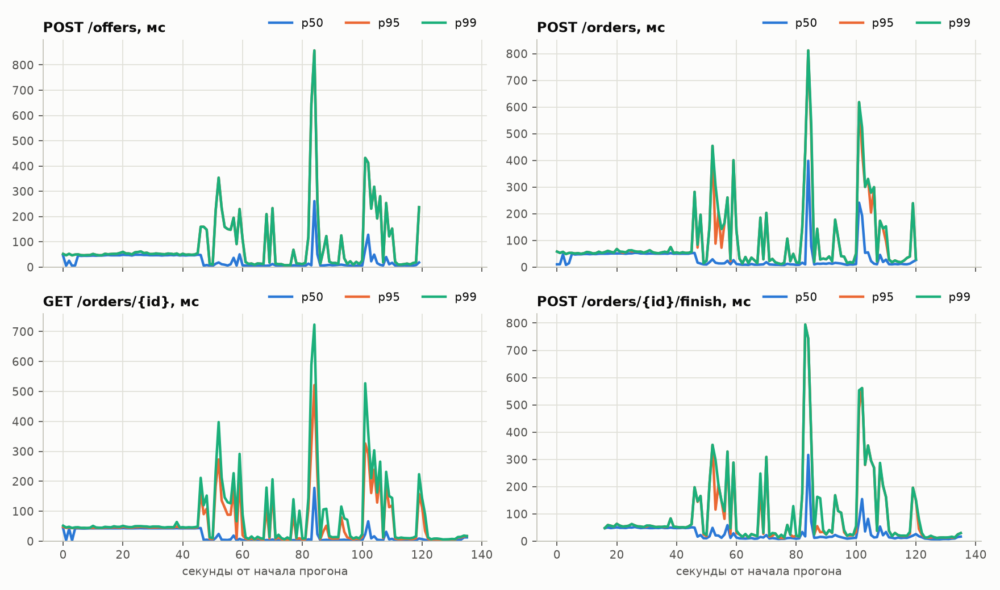
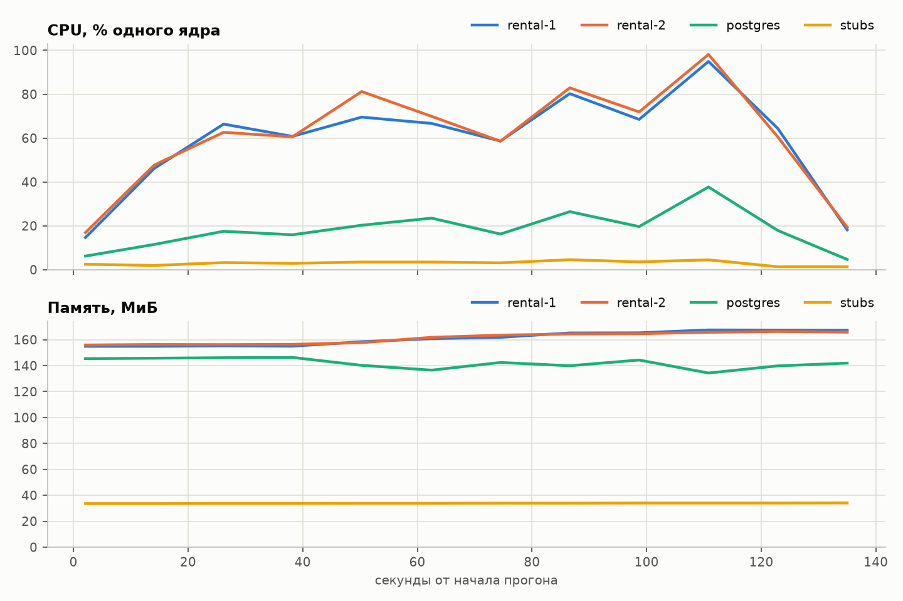

# Нагрузочный прогон

X = 20 заказов в секунду, Y = 50 просмотров на заказ, подача 120 с, поездка 15 с.

Поездок начато: 2400, завершено: 2400, с ошибкой: 0.

| Эндпоинт | Запросов | RPS | Ошибок | p50, мс | p95, мс | p99, мс | max, мс |
| --- | ---: | ---: | ---: | ---: | ---: | ---: | ---: |
| `POST /offers` | 2400 | 20 | 0 | 14.89 | 109.9 | 261.04 | 857.21 |
| `POST /orders` | 2400 | 20 | 0 | 22.4 | 89.76 | 398.3 | 812.13 |
| `GET /orders/{id}` | 120000 | 1000 | 0 | 5.95 | 64.45 | 197.16 | 1003.87 |
| `POST /orders/{id}/finish` | 2400 | 20 | 0 | 16.71 | 117.91 | 316.44 | 794.52 |

| Контейнер | CPU средний, % | CPU пик, % | Память пик, МиБ |
| --- | ---: | ---: | ---: |
| archiver | 0 | 0 | 69 |
| postgres | 18 | 38 | 146 |
| rental-1 | 59 | 95 | 168 |
| rental-2 | 61 | 98 | 166 |
| s3 | 0 | 0 | 22 |
| stubs | 3 | 5 | 34 |

